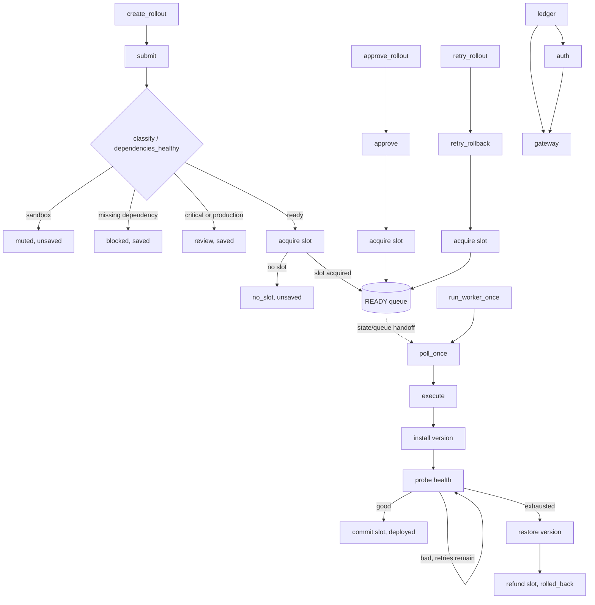

# DeployWeave conceptual graph (EVALUATOR REFERENCE: do not index)

The QUEUE connection is **not** a synchronous CALLS edge. The three service links indicate dependency impact, not function calls.
