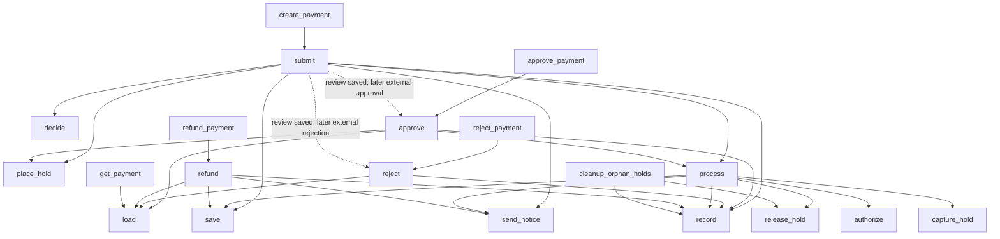

# NexusPay graph

Solid arrows: static direct calls. Dashed arrows: state-mediated workflow, **not** CALLS edges.

Important: `process()` is reached only after successful hold placement. Review decisions return early. Blocked payments return without saving. Refunds are separate entry points and do not reverse the original ledger debit in this synthetic system.
