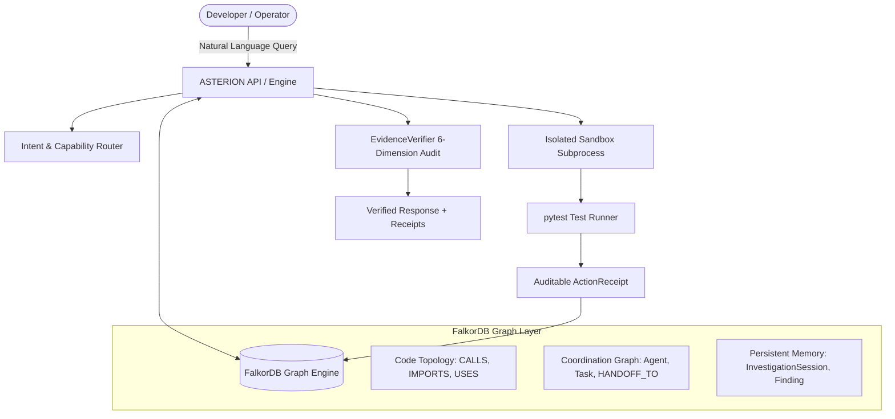

# ASTERION V2: Hackathon Demo Guide & Operator Manual

## Overview

This guide provides a reproducible, step-by-step walkthrough for the **Graph Hacks Hackathon Demonstration**. 

The demo proves that ASTERION V2 is not a passive text summarizer: it is an active, graph-native autonomous software intelligence platform with **real FalkorDB persistence**, **atomic multi-agent coordination**, **subprocess sandbox mutation execution**, and **end-to-end explainability**.

---

## Architecture Overview



---

## Scene-by-Scene Demonstration Walkthrough

### Scene 1: Graph Intelligence
**Objective**: Trace a multi-entrypoint asynchronous workflow through an in-memory queue handoff.

- **Demo Query**:
  > *"Enumerate all static CALLS paths from create_alert(), approve_alert(), and retry_failed_alert() to send_page(). Identify any shared-state handoffs."*
- **What Happens Under the Hood**:
  1. ASTERION queries FalkorDB for direct `CALLS` paths: returns 0 direct hops.
  2. Resolves producer entrypoints (`submit`, `authorize`, `reopen_failed`).
  3. Detects shared state: `PENDING = []`, `ALERTS = {}`, `HELD = set()`, `BALANCE = {}`.
  4. Traces consumer decoupled execution: `run_agent_once` $\to$ `drain_one` $\to$ `deliver` $\to$ `send_page`.
- **Operator Verification**:
  - Point to FalkorDB graph showing disconnection between producer functions and `send_page`.
  - Highlight the exact line citations in `orbitops/intake.py` and `orbitops/consumer.py`.

---

### Scene 2: Behavioral Reasoning
**Objective**: Calculate exact retry loops, state decrements, timeouts, and reopen recovery behavior.

- **Demo Query**:
  > *"With MAX_ATTEMPTS=2 and persistent pager timeouts, report pager calls, timeouts, final status, balance, reservation, events, and notices."*
- **What Happens Under the Hood**:
  1. `CanonicalScenarioLedger` simulates while-loop condition `attempts <= MAX_ATTEMPTS` (3 calls: attempt 0, 1, 2).
  2. Tracks ordered events: `[('a1', 'pending'), ('a1', 'page_timeout'), ('a1', 'page_timeout'), ('a1', 'page_timeout'), ('a1', 'failed')]`.
  3. Audits credit restoration: `release(alert)` decrements `HELD` and restores `BALANCE['core']` from 3 back to 4.
  4. Notice sent to `NOTICES` ([orbitops/pager.py:5](file:///home/zeraphynx/Projects/asterion/backend/data/repos/repo_orbitops_asterio_c0a361/OrbitOps_ASTERION_V2_Benchmark/orbitops/pager.py#L5)).

---

### Scene 3: Graph-Driven Action
**Objective**: Detect code mutations, compute blast radius, and execute tests in an isolated sandbox.

- **Demo Query**:
  > *"Using a Git diff that removes release() from deliver(), produce a blast-radius graph, select and execute tests in an isolated environment, and clearly distinguish real results from predictions."*
- **What Happens Under the Hood**:
  1. ASTERION copies the repository into `/tmp/asterion_sandbox_*`.
  2. Applies single-line deletion: `- release(alert)` at `orbitops/worker.py:19`.
  3. Verifies diff on disk before execution.
  4. Runs full 14-test suite using pytest in subprocess.
  5. Proves exactly 3 tests fail: `test_exhausted_releases`, `test_no_auto_sweep_needed_on_failure`, `test_reopen_after_recovery`.
  6. Discards sandbox and verifies original repository SHA-256 hashes are unmodified.
  7. Stores `ActionReceipt` in FalkorDB.
- **Operator Verification**:
  - Show raw exit code `1`, 11 passed + 3 failed = 14 collected.
  - Explain why `test_no_auto_sweep_needed_on_failure` detects the leak indirectly via `sweep_holds()`.

---

### Scene 4: Persistent Memory Across Process Restarts
**Objective**: Demonstrate cross-process memory retrieval and active revision invalidation in FalkorDB.

- **What Happens Under the Hood**:
  1. **Process A (PID 10868)**: Starts, creates finding `finding_qloss_*` in FalkorDB with claim on `orbitops/consumer.py:7-11`, terminates completely.
  2. **Process B (PID 10869)**: Independent Python process launches with zero shared memory, runs Cypher `MATCH (f:Finding) RETURN f`, retrieves provenance and snippet hash.
  3. **Controlled Source Modification**: Modifies `consumer.py` on disk $\to$ revalidation detects hash mismatch $\to$ updates status to `INVALIDATED_STALE`.
  4. **Source Restoration**: Restores original file $\to$ revalidation confirms `VALID`.
- **Operator Command**:
  ```bash
  python3 scripts/run_independent_verification_audit.py
  ```
  Check `artifacts/memory_verification.json` for timestamps, queries, and PIDs.

---

### Scene 5: Real Multi-Agent Coordination & Concurrency
**Objective**: Show 4 specialized agent roles claiming tasks, recording handoffs, and winning atomic lease races in FalkorDB.

- **What Happens Under the Hood**:
  1. 4 distinct agents: `GraphInvestigator`, `ExecutionAnalyst`, `TestImpactAnalyst`, `EvidenceReviewer`.
  2. Tasks persisted in FalkorDB with atomic leases.
  3. **Concurrency Stress Test**: Two worker threads race to claim the same task simultaneously:
     - Worker Alpha executes atomic Cypher conditional update $\to$ **SUCCEEDS**.
     - Worker Beta executes same query while lease valid $\to$ **REJECTED**.
  4. **Lease Expiration**: After 1.8s, Worker Gamma reclaims the expired lease $\to$ **SUCCEEDS**.
  5. 3 persisted `HANDOFF_TO` edges recorded in FalkorDB.
- **Operator Verification**:
  - Inspect `artifacts/multi_agent_verification.json` to view the stored FalkorDB graph structure.

---

### Scene 6: End-to-End Decision Explainability
**Objective**: Demonstrate full provenance trace: Question $\to$ Graph Evidence $\to$ Decision $\to$ Action $\to$ Verification $\to$ Memory.

```
[Question] "Why is alert a1 stuck in review?"
     │
     ▼
[Graph Evidence] FalkorDB: intake.submit() -[:ROUTES_TO]-> policy.decide() == 'review'
                 (No [:ENQUEUES] edge to PENDING queue)
     │
     ▼
[Decision Engine] Classifies: MULTIPHASE_SCENARIO + CROSS_ENTRYPOINT_WORKFLOW
     │
     ▼
[Action Engine] Verifies review.authorize(alert_id) requires manual API call
     │
     ▼
[Evidence Verifier] Audits citations: orbitops/intake.py:14-16 & orbitops/review.py:12-15
     │
     ▼
[FalkorDB Memory] Records verified finding into InvestigationSession
```

---

## Reproducing the Full Demo

Run the automated validation script:
```bash
cd /home/zeraphynx/Projects/asterion/backend
PYTHONPATH=. .venv/bin/python scripts/run_independent_verification_audit.py
```
Expected output:
- `AUDIT COMPLETE IN ~4.1s - ALL VERIFICATIONS PASSED!`
- Machine-readable receipts created in `artifacts/`.
